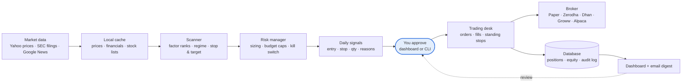
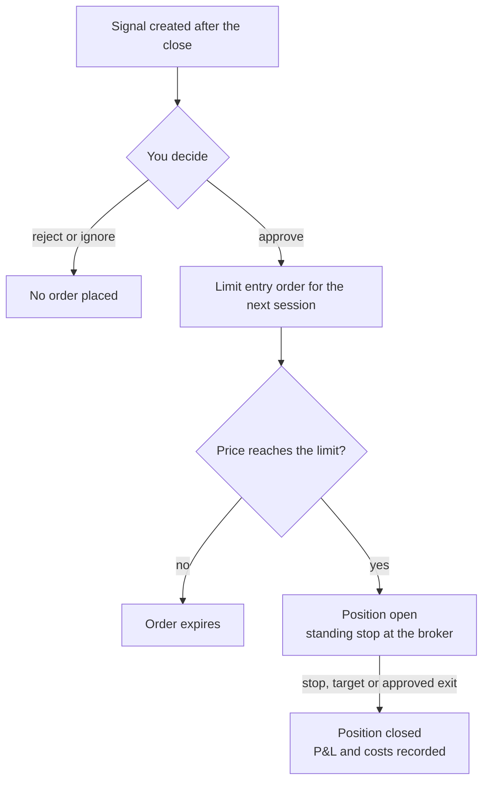

# TradeMare

An automated swing-trading engine for **Indian (NSE/BSE)** and **US** equities. It combines **fundamental**, **technical** and (optionally) **LLM-driven sentiment** analysis to produce buy/sell signals within a configured budget. Each signal is sent to a web dashboard and by email, and an order is placed **only after you approve it**.

> ⚠️ **Status: planning / early development.** This is a personal research project and **not financial advice**. Use paper trading before you risk real capital.

## Features

- **Multi-factor analysis**
  - Fundamental: quality, financial health, growth, valuation vs peers
  - Technical: trend, momentum, breakouts, ATR volatility, market-regime filter
  - Sentiment: news and announcements scored by an LLM (Claude or OpenAI, pluggable). Optional.
- **Signals with a rationale:** each signal comes with an entry, stop, target and size, plus a plain-language reason from each analyst.
- **Budget and risk control:** per-market budgets, risk sized per trade, position and sector caps, and a drawdown kill switch.
- **Configurable stop-loss:** ATR, percent, swing-low or fixed amount, with optional trailing stops and time stops.
- **Long and short:** each direction is enabled per market in config.
- **Human in the loop:** you approve, reject or edit each signal on the dashboard before any order is placed.
- **Pluggable brokers** (strategy pattern):
  - 🇮🇳 Zerodha (Kite Connect), Dhan (DhanHQ), Groww (Trade API)
  - 🇺🇸 Alpaca
  - Built-in paper broker for simulation
- **Corporate events and forensic checks:** NSE/SEC filings scanned for red flags (news headlines for BSE-only filers), upcoming results dates, and Piotroski, Altman and Beneish scores on every signal.
- **Alerts and safety nets:** WhatsApp (docs/whatsapp-setup.md), Telegram and email alerts, an intraday stop check every 15 minutes in market hours, nightly database backups, and a watchdog that alerts you if a daily run is missed.
- **Trade journal:** entry price, current profit and loss, closed-trade results, and how the signals you passed on did, plus a hint when a gain turns long-term for tax within 60 days.
- **Ask Claude:** each signal has a box to ask Claude about it, answered only from that signal's evidence (needs `ANTHROPIC_API_KEY`).
- **IPOs (India):** open, upcoming and recent NSE mainboard IPOs with live subscription by investor category, lot size and issue type, and how past IPOs with similar institutional (QIB) demand listed. A pre-registered study of 411 IPOs from 2016 to 2026 found QIB demand strongly predicts listing-day gains (`docs/research/2026-10-19-ipo-demand-plan.md`). Alerts arrive when an IPO opens and on its last afternoon of bidding. TradeMare never applies for you. `trademare ipo` lists current issues; `trademare ipo study` re-runs the study.
- **Same code in backtest, paper and live:** only the data feed and the broker adapter change between modes.

## Architecture

Every order passes the risk manager and your approval:



The backtester replays the same scanner, risk rules and fill rules over history.

A signal's life:



## Getting started

Requires [uv](https://docs.astral.sh/uv/); it installs Python 3.12 automatically.

```bash
git clone https://github.com/Mayank9mare/TradeMare.git && cd TradeMare
uv sync                       # create .venv and install dependencies
cp .env.example .env          # add broker / SMTP keys (optional for now)
uv run trademare check        # validate config and show a summary of each market
uv run pytest                 # run the test suite

# Market data (cached under data/cache/, git-ignored)
uv run trademare universe refresh          # download Nifty 200 / S&P 500 constituents
uv run trademare data update --limit 5     # quick test: 5 symbols per market
uv run trademare data update               # full: ~8 years of daily bars + fundamentals
uv run trademare data status               # what is cached

# Analysis: score every stock and propose ideas (uses cached data only)
uv run trademare scan                      # latest session, both markets
uv run trademare scan -m IN --date 2025-06-30   # any past date (point-in-time)

# Backtesting and research (cached data only; results in data/backtests/)
uv run trademare backtest -m US                                   # last 5 years, settings.yaml
uv run trademare backtest -m IN --set strategy.min_composite_score=0.5   # try a variation
uv run trademare research -m US --horizon 20                      # do the scores predict returns?

# Operations
uv run trademare health                     # missed runs, kill switch, backup age
uv run trademare db backup                  # also runs nightly under serve
uv run trademare db restore [FILE]          # list backups, or restore one (stop serve first)

# Daily trading (paper unless a market is validated)
uv run trademare serve                     # dashboard + daily job after each close (keep running)
uv run trademare daily                     # run the daily process now instead
uv run trademare signals                   # list pending signals
uv run trademare approve <id> [--qty N]    # or use the Signals page in the dashboard
uv run trademare rearm -m IN               # re-arm a tripped kill switch

# Dashboard only (no scheduler)
uv run trademare web                       # http://127.0.0.1:8000
```

**Daily flow:** after each market closes, the job refreshes data, fills paper orders against that day's
prices, updates stops, records equity, checks the kill switch, and creates new signals. You approve them
on the **Signals** page (or by CLI) before the next session. Entries become limit orders with a protective
stop, and exits fill at the next open. A digest is emailed if SMTP is configured in `.env` (Gmail app
password); otherwise it is saved to `data/outbox/`. Set `DASHBOARD_PASSWORD` in `.env` before exposing the
dashboard beyond your Mac.

US fundamentals come from SEC EDGAR, which requires a contact in `.env`:
`SEC_USER_AGENT="TradeMare you@example.com"`. Without it, the engine falls back to yfinance.

Put personal values such as your real budgets and email address in `config/settings.local.yaml`. That file is git-ignored and is deep-merged over `settings.yaml`:

```yaml
markets:
  IN: { budget: 250000, broker: zerodha }
  US: { budget: 3000 }
```

## Brokers

Paper trading needs no broker. To connect a real account, set `markets.<M>.broker` and the keys in `.env`:

| Broker | Market | `.env` | Session |
|---|---|---|---|
| Zerodha (Kite Connect) | IN | `ZERODHA_API_KEY`, `ZERODHA_API_SECRET` | Daily: `uv run trademare broker login zerodha` (tokens expire ~6 AM IST) |
| Dhan (DhanHQ v2) | IN | `DHAN_CLIENT_ID`, `DHAN_ACCESS_TOKEN` | Token from the Dhan web console (~30 days) |
| Groww (Trade API) | IN | `GROWW_API_KEY` + `GROWW_TOTP_SECRET` (or `GROWW_API_SECRET`) | TOTP key renews itself; an approval key needs approving in the Groww app daily |
| Alpaca | US | `ALPACA_API_KEY`, `ALPACA_SECRET_KEY`, `ALPACA_PAPER=true` | Keys; start with Alpaca's paper environment |

- **Protective stops** are standing broker orders that survive across sessions: GTT on Zerodha and Groww, Forever orders on Dhan, and GTC stop/OCO on Alpaca. Indian exchange stop orders are day-only, which is why these are used instead.
- **Reconciliation:** `uv run trademare broker check` compares broker holdings with TradeMare's records and flags any mismatch.
- **Safety:** a market with `validated: false` refuses all real orders. Zerodha, Dhan and Alpaca-live are only usable for a strategy that has passed its out-of-sample test. Alpaca's *paper* environment is a broker too, so it is also blocked until `validated: true`; use `broker: paper` for simulation.
- **SEBI (India):** API orders must come from a broker-whitelisted static IP, which means a VPS rather than a home connection.

## Configuration

All tunable values live in `config/settings.yaml`, so you can change them without touching code:

```yaml
markets:
  IN:
    broker: zerodha        # zerodha | dhan | groww | paper
    budget: 200000         # INR
    allow_short: false
    risk_per_trade_pct: 1.0
    stop_loss:
      method: atr          # atr | percent | swing_low | fixed_amount
      atr_multiple: 2.0
      trailing: true
```

Secrets such as broker API keys and SMTP credentials go in `.env`, which is never committed.

## Roadmap

| Phase | Deliverable |
|---|---|
| 0 ✅ | Project scaffold, config, core models |
| 1 ✅ | Data layer (prices and fundamentals for India and the US) |
| 2 ✅ | Technical and fundamental analysts, aggregator |
| 3 ✅ | Backtester with costs, in/out-of-sample split, signal research ([v1 results](docs/research/2026-10-17-strategy-v1-baseline.md)) |
| 4 ✅ | Risk and budget manager, kill switch |
| 5 ✅ | Daily signals: email digest, dashboard approve/reject, scheduler |
| 6 ✅ | Paper execution with the approve flow |
| 7 🔄 | Broker adapters built (Zerodha / Dhan / Alpaca); live use waits for a validated strategy |
| 8 ✅ | News-sentiment overlay (Claude or OpenAI), off by default ([evaluation plan](docs/research/2026-10-17-sentiment-overlay-plan.md)) |

The full design, decisions and risks are in **[PLAN.md](PLAN.md)**.

## Documentation

- **User guide:** every feature and how to use it. A copy lives in the project's Claude doc (shared separately).
- **[PLAN.md](PLAN.md):** design, decisions and risks.
- **[docs/research/](docs/research/):** pre-registered strategy research and results.
- **[deploy/README.md](deploy/README.md):** Mac auto-start (launchd) and server deployment (Docker, static IP for SEBI).

## Tech stack

Python · pandas · FastAPI + HTMX · SQLite/SQLAlchemy · APScheduler · exchange_calendars · kiteconnect · dhanhq · alpaca-py

## Compliance note (India)

Retail API trading in India falls under SEBI's algo trading framework, which covers static-IP whitelisting, order-rate thresholds and strategy registration. TradeMare is intended for **personal use only**. It does not distribute signals to others, because that would require a SEBI Research Analyst registration.

## Disclaimer

This software is provided for educational and research purposes. Trading involves substantial risk of loss. The authors accept no liability for any financial losses incurred through its use.

## License

MIT
